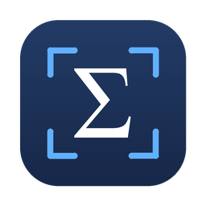
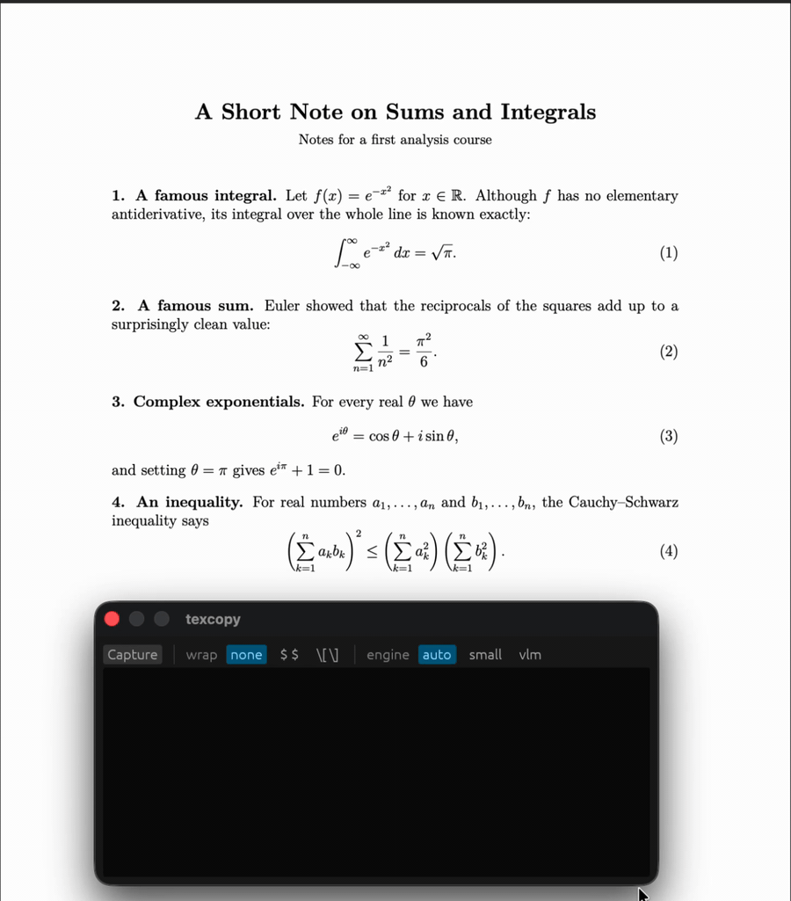

<p align="center">
  
</p>
<h1 align="center">
  <b>texcopy</b>
</h1>
<p align="center">
  <b>Select LaTeX on your screen. Paste its LaTeX.</b>
</p>

<p align="center">
  <a href="https://github.com/Phoenixxo/texcopy/actions/workflows/ci.yml"></a>
  <a href="https://github.com/Phoenixxo/texcopy/actions/workflows/tests.yml"></a>
  <a href="https://github.com/Phoenixxo/texcopy/releases"></a>
  <a href="https://github.com/Phoenixxo/texcopy/releases"></a>
  <a href="LICENSE"></a>
  
  
  
  
</p>

> [!NOTE]
> texcopy is an early release. I build and test it on my Mac (Apple Silicon). The Windows and Linux builds exist and CI runs on them, but I haven't actually run them on a real machine yet, so expect rough edges there. If something breaks, please [open an issue](https://github.com/Phoenixxo/texcopy/issues).

You're reading a textbook PDF, a paper or a slide, and you want that equation in your notes. Retyping `\frac` and `\sum_{k=1}^{n}` is slow, and you'll get something wrong.

texcopy fixes that. Drag a box around anything that was rendered with LaTeX and the LaTeX ends up on your clipboard. It's not just single formulas either. Sentences with inline math, numbered equations, lists, headings and tables work too. Everything runs on your computer. No account, no API key, nothing gets uploaded.

<p align="center">
  
</p>

<p align="center">
  <a href="#features">Features</a> -
  <a href="#install">Install</a> -
  <a href="#usage">Usage</a> -
  <a href="#what-it-can-read">What it can read</a> -
  <a href="#configuration">Configuration</a> -
  <a href="#how-accurate-is-it">Accuracy</a> -
  <a href="#faq">FAQ</a> -
  <a href="#contributing">Contributing</a>
</p>

---

## Features

- **More than formulas.** Sentences with inline math, numbered and unnumbered display equations, bullet and numbered lists, headings and tables all come back as LaTeX.
- **Looks the same, not the same source.** Aims to give you the same rendered output, without needing the source. It gives you LaTeX that renders the same as what you selected.
- **Private.** Everything runs on your machine. The only thing that touches the network is the one-time model download.
- **Fast.** About a third of a second per capture once it's warm (Apple M4 Pro). The window loads the model while you're still dragging the box.
- **App and command line.** There's a small window (a Capture button, a couple of options, the output text) and a `texcopy` command with JSON output for scripts.
- **Two engines.** A 118 MB formula model that works anywhere, and an optional 1 GB vision model that reads paragraphs, long equations and tables. The window offers the download the first time you capture.
- **Measured.** A benchmark renders known LaTeX, runs texcopy on the picture and compares the result. See [how accurate it is](#how-accurate-is-it).

## Install

Grab the file for your system from the [latest release](https://github.com/Phoenixxo/texcopy/releases/latest). Each release has SHA-256 checksums in `SHA256SUMS`.

| System | Download | Then |
|---|---|---|
| **macOS** (Apple Silicon) | `texcopy-…-macos-arm64.zip` | Unzip it, drag `texcopy.app` to Applications |
| **Windows** (x64) | `texcopy-…-windows-x64.zip` | Unzip it anywhere, run `texcopy-gui.exe` |
| **Linux** (x64) | `texcopy-…-linux-….tar.gz` | `tar xzf` it, run `./install.sh` |

<details>
<summary><b>First launch on each system</b> (the one-time security prompts)</summary>

**macOS.** The app is signed ad hoc and not notarised by Apple, so the first time macOS says it can't verify the developer. Right-click the app, choose **Open**, then **Open** again. (Or run `xattr -dr com.apple.quarantine /Applications/texcopy.app`.) The first capture asks for **Screen Recording** permission in System Settings, Privacy & Security. Allow it for texcopy and reopen the app.

**Windows.** `texcopy-gui.exe` opens the window with no console. `texcopy.exe` is the command line. SmartScreen might warn about an app it doesn't know. Choose **More info**, then **Run anyway**.

**Linux.** `./install.sh` puts the program, a menu entry and the icon under `~/.local`, no root needed (`./install.sh --remove` undoes it). For drag-to-select, install any one of `grim` + `slurp` (Wayland), `maim`, `scrot`, `spectacle`, `gnome-screenshot` or `flameshot`. If you have none, texcopy uses its own full-screen overlay.

</details>

The first time you capture, the window offers to download the vision engine (about 1 GB, checksum-verified, with a progress bar). Say "Not now" and it uses the small formula model instead. You can change your mind later with `texcopy --setup`.

Got Rust? `cargo install texcopy --locked` gets you `texcopy` and `texcopy-gui`. On Linux, install the capture and window libraries first, they're listed under [Building](#building).

Want to build it yourself? See [Building](#building).

## Usage

### The window

Open texcopy, click **Capture** (or press `C`), and drag a box over what you want. The LaTeX shows up and it's already on your clipboard. Esc closes the window.

- **wrap** puts `$ … $` or `\[ … \]` around a single formula. Sentences already have their own.
- **engine** is `auto` (default), `small` (formula model only) or `vlm` (vision model only). Changing it re-reads the same picture.
- You'll see small grey notes under the text only when something deserves a second look, like a symbol the model wasn't sure about.

### The command line

```bash
texcopy                       # open the window
texcopy formula.png           # read an image file, print the LaTeX, copy it
texcopy --clipboard           # read an image from the clipboard
texcopy --select              # drag-select in the terminal, no window
texcopy --screen --region 100,200,600,150   # capture the screen, crop to x,y,w,h
texcopy -w inline             # wrap a formula as $...$   (-w display: \[ ... \])
texcopy --no-copy             # print only, leave the clipboard alone
texcopy --json                # machine-readable: latex, engine, kind, confidence
texcopy --setup               # set up the vision engine (asks first)
texcopy --engine small|vlm|auto
```

`texcopy --help` has the rest.

## What it can read

| You select | You get |
|---|---|
| A sentence with math | `Let $G$ be a connected graph with $n$ vertices.` |
| A numbered equation | `\begin{equation} … \end{equation}` (LaTeX writes the number) |
| An unnumbered display equation | `\[ … \]` |
| A single formula | the bare LaTeX, or wrapped with `--wrap` |
| A bullet or numbered list | `itemize` / `enumerate`, nested when the bullets change |
| A heading | `\section*{…}` |
| A table | a `tabular` inside `center` |
| `& % # _ $`, quotes, dashes | escaped and converted so it compiles |
| The LaTeX logo | `\LaTeX{}` |

What it won't get back is styling that isn't part of the content: bold, italic, small caps, underline, vertical table rules, theorem boxes. Those come out as plain text. [docs/OUTPUT.md](docs/OUTPUT.md) has the details and examples.

## Configuration

The window remembers `wrap` and `engine` in a `settings.json` in your user config folder. Everything else is a flag or an environment variable:

| Variable | What it does |
|---|---|
| `TEXCOPY_ENGINE` | default engine: `auto`, `small` or `vlm` |
| `TEXCOPY_SELECTOR` | set to `overlay` to force texcopy's own selection overlay |
| `TEXCOPY_CACHE_DIR` | where models and the helper live (default: your OS cache folder) |
| `TEXCOPY_MODEL_DIR` | use a different small-model folder, see [custom models](docs/CUSTOM_MODELS.md) |
| `TEXCOPY_VLM_DIR` | folder with the vision model files |
| `TEXCOPY_LLAMA_SERVER` | path to your own `llama-server` (a GPU build, say) |

## How it works

A screenshot of LaTeX doesn't contain the LaTeX, so getting it back is OCR:

```
 drag a box ──▶ screenshot ──▶  small model   ─┐
                                (118 MB, ONNX)  ├─▶ clean up ──▶ LaTeX ──▶ clipboard
                              ┌ vision model  ─┘
                              └ (1 GB, llama.cpp, optional)
```

The small model reads one formula at a time and runs inside the program. The vision model is a 0.8 billion parameter model run by a short-lived local `llama-server`, and it reads whole pages. Whatever the model says then gets rebuilt into LaTeX that compiles: sections, lists, equation environments, tables, escaped characters. The long version is in [docs/HOW_IT_WORKS.md](docs/HOW_IT_WORKS.md).

## How accurate is it?

The benchmark (`tools/bench.py`) renders known LaTeX with `pdflatex`, runs texcopy on the picture, then re-renders the answer and compares. On an Apple M4 Pro with the vision engine:

| Test | Exact | Notes |
|---|---:|---|
| 45 real textbook exercises | **44 / 45** | the other one drops a full stop |
| Single formulas, simple to nested | **15 / 15** | |
| Same formulas at 50-800 dpi, blurred, noisy, inverted, JPEG | **28 / 30** | the other two are close |
| Tables, graded on their cells | **16 / 18** | |

That's a benchmark, not a promise, so **proofread what you paste.** A confident answer can still be wrong, usually a symbol that looks like another one (`\epsilon` and `e`, an italic `v` and `\nu`). The full results, and a list of where it gets things wrong, are in [docs/BENCHMARKS.md](docs/BENCHMARKS.md#where-it-gets-things-wrong). If you find a case it gets wrong, [open an issue](https://github.com/Phoenixxo/texcopy/issues/new/choose).

## Privacy

texcopy never uploads your screenshots or your text. It only goes online to download the models and the helper, once: the small model and the vision model from Hugging Face, and `llama-server` from GitHub. Every file's size and SHA-256 get checked before it's used and will be deleted if there is a mismatch.

## FAQ

<details>
<summary><b>macOS says it can't verify the developer</b></summary>

See [first launch](#install) above: right-click, **Open**. The app isn't notarised because that needs a paid Apple developer account.
</details>

<details>
<summary><b>The capture is blank or black on macOS</b></summary>

texcopy needs **Screen Recording** permission (System Settings, Privacy & Security). Allow it, then quit and reopen the app. If you're running it from a terminal, the permission belongs to that terminal.
</details>

<details>
<summary><b>The first capture is slow</b></summary>

The first read after installing starts the vision model, which can take a few seconds (longer while macOS checks the freshly downloaded helper). After that the window keeps it loaded, so a read takes a fraction of a second. It unloads itself after a few idle minutes to free about 1.4 GB of memory.
</details>

<details>
<summary><b>My centred text came back as a <code>\section*</code></b></summary>

The model treats centred, prominent text as a heading and texcopy can't tell it from a real one. Just change it by hand.
</details>

<details>
<summary><b>Does it work offline?</b></summary>

Yes, once the models are downloaded.
</details>

<details>
<summary><b>Which LaTeX packages does the output need?</b></summary>

`amsmath` for `equation`, `align` and matrices. Tables, sections and lists don't need anything extra.
</details>

<details>
<summary><b>Can it read handwriting or a photo of a page?</b></summary>

It's built and measured for rendered LaTeX on a screen. Other stuff might work, but I haven't tested it.
</details>

## Building

```bash
git clone https://github.com/Phoenixxo/texcopy.git
cd texcopy
cargo build --release          # binaries in target/release: texcopy and texcopy-gui
cargo test
```

You need Rust 1.95 or newer ([rustup.rs](https://rustup.rs)). The first build downloads a prebuilt ONNX Runtime. On Linux, install the capture and window libraries first:

```bash
sudo apt-get install pkg-config libclang-dev libxcb1-dev libxrandr-dev libdbus-1-dev \
  libpipewire-0.3-dev libwayland-dev libegl-dev libxkbcommon-dev libx11-dev \
  libxcursor-dev libxi-dev libgl1-mesa-dev libgbm-dev
```

## Contributing

Contributions are welcome. Wrong or malformed output is expected in plenty of cases, so [issues](https://github.com/Phoenixxo/texcopy/issues/new/choose) are welcome too, and pull requests that fix them even more. A screenshot of what you selected helps the most. Read [CONTRIBUTING.md](CONTRIBUTING.md) first, it covers the setup, the benchmark (and why to compare against the previous build) and the commit style. By taking part you agree to the [Code of Conduct](CODE_OF_CONDUCT.md).

## Acknowledgements

texcopy runs on other people's models and runtimes:

- [pix2text-mfr](https://huggingface.co/breezedeus/pix2text-mfr) by breezedeus (MIT): the small formula model.
- [OvisOCR2](https://huggingface.co/bartowski/ATH-MaaS_OvisOCR2-GGUF) (Apache-2.0), GGUF conversion by bartowski: the vision model.
- [ONNX Runtime](https://onnxruntime.ai) (MIT): runs the small model.
- [llama.cpp](https://github.com/ggml-org/llama.cpp) (MIT): runs the vision model.

The models and llama.cpp get downloaded the first time you use them. They aren't bundled in the app.

## 📄 License

[MIT](LICENSE). Do what you want with it.
