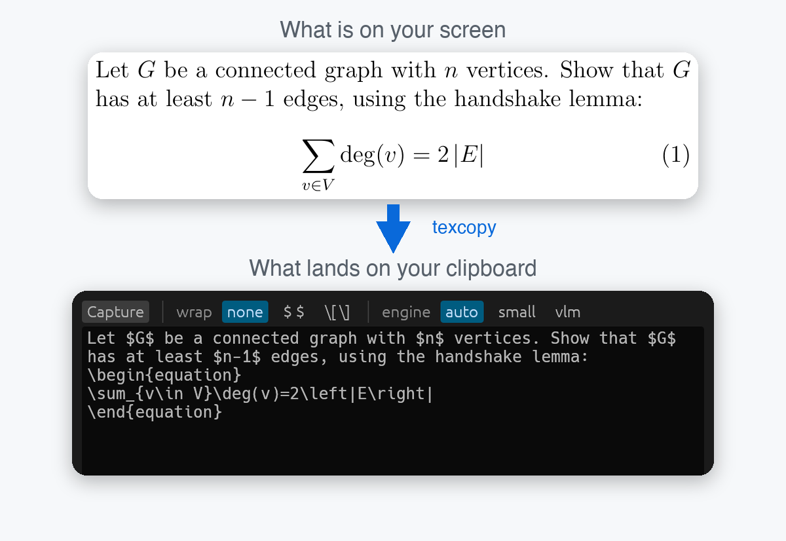

<p align="center">
  
</p>
<h1 align="center">
  <b>texcopy</b>
</h1>
<p align="center">
  <b>Select LaTeX on your screen. Paste its LaTeX.</b>
</p>

<p align="center">
  <a href="https://github.com/Phoenixxo/texcopy/actions/workflows/ci.yml"></a>
  <a href="https://github.com/Phoenixxo/texcopy/actions/workflows/tests.yml"></a>
  <a href="https://github.com/Phoenixxo/texcopy/releases"></a>
  <a href="https://github.com/Phoenixxo/texcopy/releases"></a>
  <a href="LICENSE"></a>
  
  
  
  
</p>

> [!NOTE]
> texcopy is an early release. It is developed and tested on macOS (Apple Silicon). The Windows and Linux builds are produced and tested by CI, but have not yet been run by hand on real machines, so expect rough edges there and please [report them](https://github.com/Phoenixxo/texcopy/issues).

You are reading a textbook PDF, a paper, or a lecture slide, and you want that equation in your notes. Retyping `\frac`, `\sum_{k=1}^{n}` and friends is slow, and you *will* make a typo.

**texcopy** lets you drag a box around anything LaTeX-rendered on your screen and puts the LaTeX on your clipboard. Not just single formulas: whole sentences with inline math, numbered equations, lists, headings and tables too. It runs entirely on your computer. No account, no API key, nothing uploaded.

<p align="center">
  
</p>

<p align="center">
  <a href="#-features">Features</a> •
  <a href="#-install">Install</a> •
  <a href="#-usage">Usage</a> •
  <a href="#-what-it-can-read">What it can read</a> •
  <a href="#-configuration">Configuration</a> •
  <a href="#-how-accurate-is-it">Accuracy</a> •
  <a href="#-faq">FAQ</a> •
  <a href="#-contributing">Contributing</a>
</p>

---

## ✨ Features

- **More than formulas.** Sentences with inline math, numbered and unnumbered display equations, bullet and numbered lists, section headings and tables all come back as LaTeX.
- **A correct reconstruction, not a guess at the source.** A picture cannot tell `\textbf{x}` from `{\bf x}`, so texcopy gives you LaTeX that *renders the same as what you selected*. The content is what you get; the author's exact markup is not recoverable.
- **Private by design.** Everything runs on your machine. The only network traffic is the one-time download of the models.
- **Fast.** About a third of a second per capture once warm (Apple M4 Pro). The window loads the model while you are still dragging out the box.
- **A real app and a real command line.** A small window (Capture button, a couple of options, the output text) for everyday use, and a scriptable `texcopy` CLI with JSON output.
- **Two engines.** A 118 MB formula model that works anywhere, and an optional 1 GB vision model that reads paragraphs, long equations and tables. The window offers the download on first run.
- **Measured, not just demoed.** A benchmark renders known LaTeX, runs texcopy on the picture and compares the result; see [how accurate it is](#-how-accurate-is-it).

## 📦 Install

Download the file for your system from the [latest release](https://github.com/Phoenixxo/texcopy/releases/latest). Every release lists SHA-256 checksums in `SHA256SUMS`.

| System | Download | Then |
|---|---|---|
| **macOS** (Apple Silicon) | `texcopy-…-macos-arm64.zip` | Unzip, drag `texcopy.app` to Applications |
| **Windows** (x64) | `texcopy-…-windows-x64.zip` | Unzip anywhere, run `texcopy-gui.exe` |
| **Linux** (x64) | `texcopy-…-linux-….tar.gz` | `tar xzf` it, run `./install.sh` |

<details>
<summary><b>First launch on each system</b> (the one-time security prompts)</summary>

**macOS.** The app is signed ad hoc, not notarised by Apple, so the first time macOS says it cannot verify the developer. Right-click the app, choose **Open**, then **Open** again. (Or run `xattr -dr com.apple.quarantine /Applications/texcopy.app`.) The first capture asks for **Screen Recording** permission under System Settings, Privacy & Security; allow it for texcopy and reopen the app.

**Windows.** `texcopy-gui.exe` opens the window with no console; `texcopy.exe` is the command line. SmartScreen may warn about an unrecognised app: choose **More info**, then **Run anyway**.

**Linux.** `./install.sh` installs the program, a menu entry and the icon under `~/.local` with no root (`./install.sh --remove` undoes it). For drag-to-select, install any one of `grim` + `slurp` (Wayland), `maim`, `scrot`, `spectacle`, `gnome-screenshot` or `flameshot`. Without one, texcopy uses its own full-screen overlay.

</details>

The first time you capture, the window offers to download the vision engine (about 1 GB, checksum-verified, with a progress bar). Say "Not now" and it uses the small formula model instead. You can change your mind later with `texcopy --setup`.

To build from source instead, see [Building](#-building).

## 🚀 Usage

### The window

Open texcopy, click **Capture** (or press `C`), and drag a box over what you want. The LaTeX appears and is already on your clipboard. Esc closes the window.

- **wrap** puts `$ … $` or `\[ … \]` around a single formula (sentences already carry their own).
- **engine** picks `auto` (the default), `small` (formula model only) or `vlm` (vision model only). Changing it re-reads the same picture.
- Small grey notes appear under the text only when something deserves a second look, such as a symbol the model was unsure about.

### The command line

```bash
texcopy                       # open the window
texcopy formula.png           # read an image file, print the LaTeX, copy it
texcopy --clipboard           # read an image from the clipboard
texcopy --select              # drag-select in the terminal, no window
texcopy --screen --region 100,200,600,150   # capture the screen, crop to x,y,w,h
texcopy -w inline             # wrap a formula as $...$   (-w display: \[ ... \])
texcopy --no-copy             # print only, leave the clipboard alone
texcopy --json                # machine-readable: latex, engine, kind, confidence
texcopy --setup               # set up the vision engine (asks first)
texcopy --engine small|vlm|auto
```

Run `texcopy --help` for everything.

## 📝 What it can read

| You select | You get |
|---|---|
| A sentence with math | `Let $G$ be a connected graph with $n$ vertices.` |
| A numbered equation | `\begin{equation} … \end{equation}` (LaTeX writes the number) |
| An unnumbered display equation | `\[ … \]` |
| A single formula | the bare LaTeX, or wrapped with `--wrap` |
| A bullet or numbered list | `itemize` / `enumerate`, nested when the bullets change |
| A heading | `\section*{…}` |
| A table | a `tabular` inside `center` |
| `& % # _ $`, quotes, dashes | escaped and converted so the result compiles |
| The LaTeX logo | `\LaTeX{}` |

**What it will not recover** is styling that is not part of the content: bold, italic, small caps, underline, vertical table rules, theorem boxes. They come back as plain text. The details, with examples, are in [docs/OUTPUT.md](docs/OUTPUT.md).

## ⚙️ Configuration

Your window choices (`wrap`, `engine`) are remembered in `settings.json` in your user config folder. Everything else is a flag or an environment variable:

| Variable | What it does |
|---|---|
| `TEXCOPY_ENGINE` | default engine: `auto`, `small` or `vlm` |
| `TEXCOPY_SELECTOR` | set to `overlay` to force texcopy's own selection overlay |
| `TEXCOPY_CACHE_DIR` | where models and the helper are stored (default: your OS cache folder) |
| `TEXCOPY_MODEL_DIR` | use a different small-model folder; see [custom models](docs/CUSTOM_MODELS.md) |
| `TEXCOPY_VLM_DIR` | folder holding the vision model files |
| `TEXCOPY_LLAMA_SERVER` | path to your own `llama-server` (for example a GPU build) |

## 🧠 How it works

LaTeX output (a screenshot, a PDF page) does not contain its source, so recovering it is OCR:

```
 drag a box ──▶ screenshot ──▶  small model   ─┐
                                (118 MB, ONNX)  ├─▶ clean up ──▶ LaTeX ──▶ clipboard
                              ┌ vision model  ─┘
                              └ (1 GB, llama.cpp, optional)
```

The small model reads one formula at a time and runs inside the program. The vision model is a 0.8-billion-parameter model run by a short-lived local `llama-server`; it reads whole pages. Whatever the model says is then rebuilt into compilable LaTeX: sections, lists, equation environments, tables, escaped characters. Full walkthrough: [docs/HOW_IT_WORKS.md](docs/HOW_IT_WORKS.md).

## 📊 How accurate is it?

The benchmark (`tools/bench.py`) renders known LaTeX with `pdflatex`, runs texcopy on the picture, and re-renders the answer to compare. On an Apple M4 Pro with the vision engine:

| Test | Exact | Notes |
|---|---:|---|
| 45 real textbook exercises | **44 / 45** | the other drops a full stop |
| Single formulas, simple to nested | **15 / 15** | |
| Same formulas at 50-800 dpi, blurred, noisy, inverted, JPEG | **28 / 30** | the other two are close |
| Tables, graded on their cells | **16 / 18** | |

That is a benchmark, not a promise: **proofread what you paste.** A confident answer can still be wrong, typically a symbol that looks like another (`\epsilon` and `e`, an italic `v` and `\nu`). Full results, methods and known limits are in [docs/BENCHMARKS.md](docs/BENCHMARKS.md).

## 🔒 Privacy

texcopy never uploads your screenshots or text. It makes network requests only to download the models and the helper, once: the small model from Hugging Face, the vision model from Hugging Face, and `llama-server` from GitHub. Each file's size and SHA-256 are checked before it is used, and a mismatch deletes it.

## ❓ FAQ

<details>
<summary><b>macOS says it cannot verify the developer</b></summary>

See [first launch](#-install) above: right-click, **Open**. The app is not notarised because that needs a paid Apple developer account.
</details>

<details>
<summary><b>The capture is blank or black on macOS</b></summary>

texcopy needs **Screen Recording** permission (System Settings, Privacy & Security). Allow it, then quit and reopen the app. When running from a terminal, the permission belongs to that terminal.
</details>

<details>
<summary><b>The first capture is slow</b></summary>

The first read after installing starts the vision model, which can take several seconds (longer while macOS checks the freshly downloaded helper). After that the window keeps it loaded, so reads take a fraction of a second. It unloads itself after a few idle minutes to free about 1.4 GB of memory.
</details>

<details>
<summary><b>My centred text came back as a <code>\section*</code></b></summary>

The model marks centred, prominent text as a heading and texcopy cannot tell the difference from a real one. Change it by hand.
</details>

<details>
<summary><b>Does it work offline?</b></summary>

Yes, once the models are downloaded.
</details>

<details>
<summary><b>Which LaTeX packages does the output need?</b></summary>

`amsmath` for `equation`, `align` and matrices. Tables, sections and lists need nothing extra.
</details>

<details>
<summary><b>Can it read handwriting or a photo of a page?</b></summary>

It is built and measured for rendered LaTeX on a screen. Other inputs may work but are untested.
</details>

## 🔧 Building

```bash
git clone https://github.com/Phoenixxo/texcopy.git
cd texcopy
cargo build --release          # binaries in target/release: texcopy and texcopy-gui
cargo test
```

You need Rust 1.95 or newer ([rustup.rs](https://rustup.rs)). The first build downloads a prebuilt ONNX Runtime. On Linux, install the capture and window libraries first:

```bash
sudo apt-get install pkg-config libclang-dev libxcb1-dev libxrandr-dev libdbus-1-dev \
  libpipewire-0.3-dev libwayland-dev libegl-dev libxkbcommon-dev libx11-dev \
  libxcursor-dev libxi-dev libgl1-mesa-dev
```

`cargo build --release --no-default-features` builds just the command line, without the window or screen capture and without those libraries. Packaging scripts for the macOS app, the Windows zip and the Linux tarball are in [`packaging/`](packaging); pushing a tag like `v0.1.0` makes CI build and publish all three.

## 🧭 Roadmap

Ideas, not promises:

- Run and fix the Windows and Linux builds on real machines (the most useful contribution right now).
- A global keyboard shortcut and a menu-bar / tray icon.
- Notarised macOS builds, plus Homebrew, winget and Scoop packages.
- Reading very long paragraphs by splitting them into lines.
- Training a smaller model of our own, and a much smaller ONNX Runtime build.

## 🤝 Contributing

Contributions are welcome, and bug reports with a screenshot are the most valuable of all. Read [CONTRIBUTING.md](CONTRIBUTING.md) first: it explains the setup, the benchmark (and why to compare against the previous build), and the commit style. By taking part you agree to the [Code of Conduct](CODE_OF_CONDUCT.md).

## 🙏 Acknowledgements and licenses

texcopy is [MIT licensed](LICENSE), and it stands on other people's work. The main pieces:

| Component | What it does here | License |
|---|---|---|
| [pix2text-mfr](https://huggingface.co/breezedeus/pix2text-mfr) by breezedeus | the small formula model (downloaded on first run) | MIT |
| [OvisOCR2](https://huggingface.co/bartowski/ATH-MaaS_OvisOCR2-GGUF), GGUF conversion by bartowski | the vision model (optional download) | Apache-2.0 |
| [llama.cpp](https://github.com/ggml-org/llama.cpp) | runs the vision model (a downloaded helper, `llama-server`) | MIT |
| [ONNX Runtime](https://onnxruntime.ai), through [`ort`](https://crates.io/crates/ort) | runs the small model, linked into the program | MIT |
| [egui / eframe](https://github.com/emilk/egui) | the window; its bundled fonts are OFL-1.1 and Ubuntu Font License | MIT or Apache-2.0 |
| [xcap](https://crates.io/crates/xcap), [arboard](https://crates.io/crates/arboard) | screen capture, clipboard | Apache-2.0; MIT or Apache-2.0 |
| [image](https://crates.io/crates/image), [tokenizers](https://crates.io/crates/tokenizers), [clap](https://crates.io/crates/clap), [ureq](https://crates.io/crates/ureq) and others | image decoding, tokenizing, the command line, downloads | MIT or Apache-2.0 |

In total texcopy is built from about 500 Rust crates. All of them are under permissive licenses (MIT, Apache-2.0, BSD, ISC, Zlib and similar); none requires GPL, AGPL or LGPL terms. (A few offer one of those *as an option* next to a permissive one, and texcopy uses the permissive one. One crate, `option-ext`, is MPL-2.0 and is used unmodified.) The models and the helper are downloaded, not bundled.

The license notices these licenses require ship with every download as `THIRD_PARTY_LICENSES.md` (inside `texcopy.app/Contents/Resources` on macOS), generated from `Cargo.lock` by `tools/third_party_licenses.py` so they always match the code.

## 📄 License

[MIT](LICENSE). Use it, change it, ship it.
